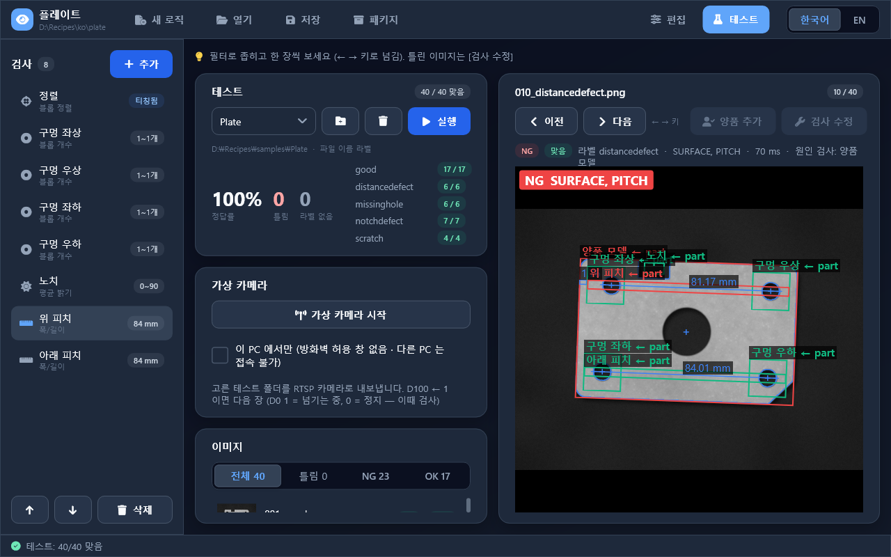
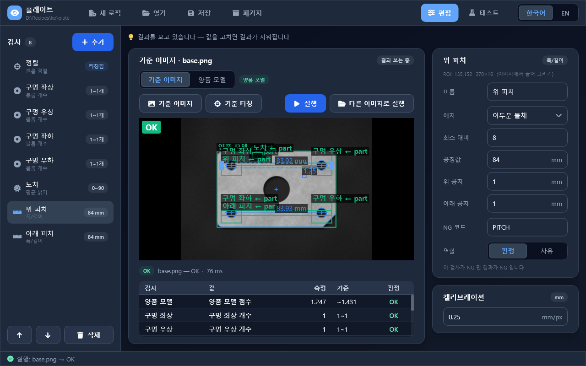

# Devinno.Vision

[English](https://github.com/devinno-kr/Devinno.Vision/blob/main/README.md) | 한국어

[OpenCvSharp4](https://github.com/shimat/opencvsharp) 위에 만든 .NET 9 비전 검사 라이브러리와 티칭 도구(Devinno.Vision.Studio)입니다.

이미지 한 장이 작업(단계 목록) 하나를 거쳐 결과 하나로 나옵니다: OK / NG / Error, NG 코드, 측정값, 오버레이. 검사는 Studio 에서 만들어 레시피로 불러오거나, C# 로 단계를 직접 씁니다.

- 실행 중에 만든 이미지는 자동으로 해제되고, 좌표는 원본 이미지 기준으로 되돌려집니다.
- ROI 는 부품을 따라갑니다 (정렬 pose).
- 검사 문제로 예외를 던지지 않습니다. 결과의 NG 또는 Error 로 나옵니다.
- 단계마다 시간 제한이 있고, 검사하지 못한 부품은 OK 로 나오지 않습니다.
- 작은 툴킷: 블롭, 밝기, 캘리퍼, 원형 부품 정렬, 양품과의 차이.
- ONNX 모델을 CPU 에서 실행 (ONNX Runtime): 양품 기반 이상 탐지, 불량 분류.

> 첫 버전입니다. API 는 바뀔 수 있습니다.

## 패키지

| 패키지 | 내용 |
|---|---|
| `Devinno.Vision` | 라이브러리: 이미지, 작업, 결과, 레시피, 툴킷, 카메라 인터페이스, 이미지 폴더 · RTSP 카메라 |
| `Devinno.Vision.UI` | `DvVisionView`: [Devinno.UI](https://github.com/devinno-kr/Devinno.UI) 화면에 결과(이미지, 오버레이, 판정)를 보여 주고, 작업자가 ROI 를 끌어 고칠 수 있습니다 |
| `Devinno.Vision.FlashCap` | `FlashCapCamera`: USB (UVC) 카메라. [FlashCap](https://github.com/kekyo/FlashCap) 기반 |

Devinno.Vision.Studio 는 패키지가 아니라 앱입니다. 이 저장소에 있습니다 ([Studio](#studio) 참고).

## 설치

`Devinno.Vision` 은 `OpenCvSharp4` 와 `Microsoft.ML.OnnxRuntime` 을 함께 가져옵니다. OpenCV 네이티브 런타임 패키지는 직접 추가해야 하며, `Devinno.Vision` 이 참조하는 `OpenCvSharp4` 와 같은 버전이어야 합니다. Windows 에서는:

```xml
<ItemGroup>
  <PackageReference Include="Devinno.Vision" Version="0.1.0" />
  <PackageReference Include="OpenCvSharp4.runtime.win" Version="4.13.0.20261107" />
</ItemGroup>
```

없으면 첫 이미지 호출이 `OpenCvSharpExtern` 을 언급하는 예외로 실패합니다. 다른 플랫폼에는 각자의 `OpenCvSharp4.runtime.*` 패키지가 있으나, 이 라이브러리로 검증하지 않았습니다.

## 레시피 실행

레시피는 Studio 가 저장한 것입니다: `studio.json` 이 든 폴더, 또는 `.dvpkg` 패키지 파일 하나.

```csharp
using Devinno.Vision;

using var recipe = VisionRecipe.Load(@"C:\recipes\plate");   // studio.json 이 든 폴더, 또는 .dvpkg 파일
var job = recipe.CreateJob();                                    // 한 번 만들어 여러 번 실행

using var img = VisionImage.Load(@"C:\images\part01.bmp");
using var r = await job.RunAsync(img);

switch (r.State)
{
    case VisionState.Ok:    /* 합격 */ break;
    case VisionState.Ng:    Console.WriteLine(string.Join(", ", r.Codes)); break;   // "HOLE, LENGTH"
    case VisionState.Error: Console.WriteLine(r.Error); break;                       // 검사하지 못함
}
foreach (var v in r.Values)
    Console.WriteLine($"{v.Name} = {v.Value:0.##} {v.Unit} ({(v.Ok ? "OK" : v.Code)})");
```

## C# 로 검사 작성

Studio 없이 같은 종류의 검사를 씁니다. 작업은 단계 목록이고, 각 단계는 자기 ROI 를 보고, 찾은 것을 그리고, 한계가 있는 값을 기록합니다.

```csharp
using Devinno.Vision;

var job = new VisionJob("plate")
    .Add("align", pose: "body", ctx =>
    {
        var part = Blob.Find(ctx.Image, minArea: 20000).FirstOrDefault();
        if (part is null) { ctx.Fail("part not found"); return; }
        ctx.SetPose(VisionPose.FromBlob(part), reference: new VisionPose(319.1, 240.7, -2.3));   // reference = 기준 이미지에서의 pose
    })
    .Add("left hole", roi: () => VisionRoi.Rect(138, 130, 60, 60), ctx =>
    {
        var holes = Blob.Find(ctx.Image, ThresholdMode.Fixed, threshold: 80, invert: true, minArea: 300);
        ctx.Draw(holes);
        ctx.Value("left holes", holes.Length, min: 1, max: 1, code: "HOLE");
    })
    .Add("length", roi: () => VisionRoi.Rect(100, 180, 440, 12), ctx =>
    {
        var e = Edge.Caliper(ctx.Image, EdgePolarity.BrightObject, minContrast: 8);
        ctx.Draw(e);
        ctx.Value("length", e.Distance, nominal: 400, plus: 5, minus: 5, code: "LENGTH", unit: "px");
    });

using var img = VisionImage.Load(path);
using var r = await job.RunAsync(img);
```

## Studio

Devinno.Vision.Studio 는 티칭 도구입니다. 코드를 쓰지 않고 검사를 만들고, 라벨이 붙은 이미지로 확인하고, 라인용으로 묶어 내는 Windows 앱입니다 (Devinno.UI 로 만들었습니다).





스크린샷의 부품은 합성 샘플(코드로 생성한 프레스 플레이트)이며 실제 제품이 아닙니다.

- **편집**: 기준 이미지를 정하고, 검사(블롭 정렬, 블롭 개수, 픽셀 수, 밝기, 폭/길이, ONNX)를 추가하고, 이미지 위에서 ROI 를 끌어 그리고, 실행해서 오버레이와 값을 봅니다.
- **양품 모델**: 양품 이미지 폴더를 지정해 이상 탐지 모델을 학습합니다. Python 이 필요 없습니다.
- **불량 모델**: 불량 이미지 폴더로 분류 모델을 학습하거나 (Studio 가 준비하는 Python + PyTorch 환경 사용), 이미 있는 `.onnx` 를 가져옵니다.
- **테스트**: 라벨이 붙은 이미지 폴더로 로직을 돌려 라벨별 정답률을 보고, 틀린 이미지를 한 장씩 넘겨 봅니다.
- **가상 카메라**: 테스트 폴더를 RTSP 로 내보내고 Modbus TCP 로 트리거를 받습니다. 카메라 없이 라인 프로그램을 시험할 수 있습니다.
- **패키지**: 로직을 `.dvpkg` 파일 하나로 씁니다. 라인 프로그램은 `VisionRecipe.Load` 로 엽니다.
- **MCP**: 모든 명령이 MCP 도구이기도 합니다. Studio 가 떠 있는 동안 `http://127.0.0.1:5199/mcp` (이 PC 에서만) 로 열리므로, AI 도구가 검사를 만들고 테스트하고 결과 이미지를 볼 수 있습니다.
- 화면은 한국어 또는 영어입니다.

[릴리스](https://github.com/devinno-kr/Devinno.Vision/releases)(태그 `studio-v…`, Windows x64)에서 zip 을 받아 풀고 `Devinno.Vision.Studio.exe` 를 실행합니다. .NET 9 SDK, 또는 .NET 9 Desktop Runtime 과 ASP.NET Core Runtime 9 가 있어야 합니다. zip 에는 AI 도구용 `llms.txt`(MCP 로 연결하는 방법)가 들어 있습니다. 저장소에서 바로 실행할 수도 있습니다:

```
dotnet run --project src/Devinno.Vision.Studio
```

Studio 와 NuGet 패키지는 버전과 릴리스가 따로입니다. 저장소에도 zip 에도 없는 선택 파일: 양품 모델의 특징 모델 (`tools/models/features.onnx`, `tools/export_features.py` 로 만듭니다), 가상 카메라용 MediaMTX (`tools/mediamtx/`).

## 문서

아래 문서는 패키지의 `docs/` 폴더에 들어 있습니다 (영어).

- [llms.txt](https://github.com/devinno-kr/Devinno.Vision/blob/main/llms.txt): 시작점 (질문 → 문서)
- [llm-rules.md](https://github.com/devinno-kr/Devinno.Vision/blob/main/llm-rules.md): 규칙, 프로젝트 설정, 최소 예제, 증상 → 원인 → 해결. 먼저 읽으세요.
- [vision-recipe.md](https://github.com/devinno-kr/Devinno.Vision/blob/main/vision-recipe.md): 레시피, 결과, 패키지, 양품 모델
- [vision-jobs.md](https://github.com/devinno-kr/Devinno.Vision/blob/main/vision-jobs.md): 작업, 단계, ROI 와 pose, 판정, 이미지
- [vision-toolkit.md](https://github.com/devinno-kr/Devinno.Vision/blob/main/vision-toolkit.md): 툴킷, ONNX, 카메라
- C# API: 패키지의 IntelliSense XML (영어, 한국어는 `ko/` 아래)

## AI 도구용 문서

Devinno.Vision 을 참조한 프로젝트를 빌드하면 패키지 문서와 영어 IntelliSense XML 이 프로젝트 폴더의 `.devinno/Devinno.Vision/` 으로 복사됩니다. AI 코딩 도구가 거기서 읽습니다.

- AI 지시 파일(`CLAUDE.md`, `AGENTS.md` 등)에 이 줄을 추가하세요: `Devinno library docs: read .devinno/*/llms.txt first.`
- 복사를 끄려면 프로젝트 파일에 `<DevinnoCopyDocs>false</DevinnoCopyDocs>`.
- `.devinno/` 는 `.gitignore` 에 넣기를 권합니다 (빌드할 때마다 다시 만들어집니다).

## 저장소 (저장소에만 해당)

| 경로 | 내용 |
|---|---|
| `src/Devinno.Vision` | 코어 라이브러리 |
| `src/Devinno.Vision.UI` | Devinno.UI 용 결과 화면 (`DvVisionView`) |
| `src/Devinno.Vision.FlashCap` | USB 카메라 드라이버 (`FlashCapCamera`) |
| `src/Devinno.Vision.Studio` | 티칭 도구 (WinForms 호스트, Devinno.UI 화면, MCP 서버) |
| `tests/` | 라이브러리와 Studio 의 xUnit 테스트 |
| `tools/` | 특징 모델 · 불량 학습 스크립트, 한국어 IntelliSense 점검 도구 |
| `i18n/ko` | 한국어 IntelliSense XML |

## 면책

Devinno.Vision 은 어떤 보증도 없이 "있는 그대로" 제공됩니다 (`LICENSE` 참고).

검사 결과는 직접 설정한 이미지, 조명, 한계값, 모델에 따라 달라집니다. 이 라이브러리는 불량이 NG 로, 양품이 OK 로 판정된다고 보장하지 않으며, 안전 기능용으로 설계되거나 인증받지 않았습니다. 이것으로 만든 검사는 사용자가 자기 라인의 양품 · 불량 샘플을 충분히 써서 직접 시험하고 검증해야 합니다.

## 라이선스

[MIT](https://github.com/devinno-kr/Devinno.Vision/blob/main/LICENSE)
