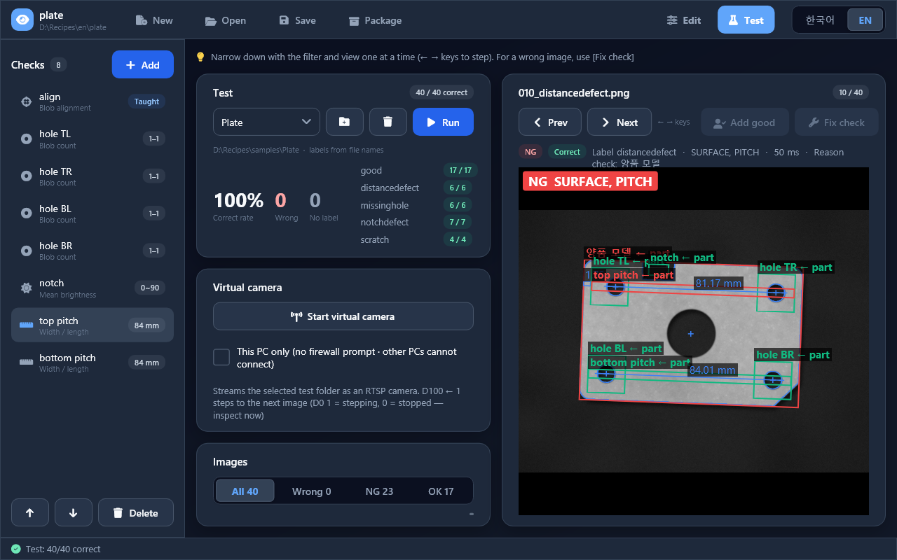
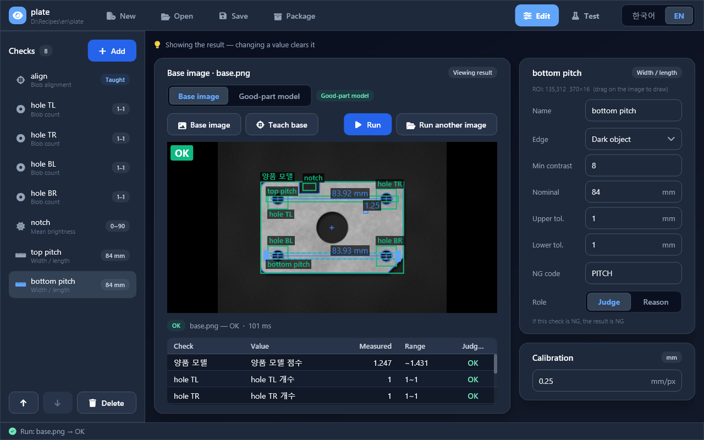

# Devinno.Vision

English | [한국어](https://github.com/devinno-kr/Devinno.Vision/blob/main/README.ko.md)

A .NET 9 vision inspection library on [OpenCvSharp4](https://github.com/shimat/opencvsharp), with a teaching tool (Devinno.Vision.Studio).

One image goes into one job (a list of steps) and comes out as one result: OK / NG / Error, NG codes, measured values and overlays. An inspection is either made in Studio and loaded as a recipe, or written in C# as steps.

- Images are released automatically inside a run, and coordinates are tracked back to the original image.
- ROIs follow the part (alignment pose).
- A run does not throw for inspection problems: they come out as NG or Error in the result.
- Steps have timeouts; a part that was not inspected does not come out OK.
- A small toolkit: blobs, brightness, caliper, round-part alignment, difference against good parts.
- ONNX models on CPU (ONNX Runtime): anomaly detection from good parts, defect classifier.

> This is the first version. The API may change.

## Packages

| Package | What it is |
|---|---|
| `Devinno.Vision` | The library: images, jobs, results, recipes, toolkit, camera interface, image-folder and RTSP cameras |
| `Devinno.Vision.UI` | `DvVisionView`: shows a result (image, overlays, judgment) on a [Devinno.UI](https://github.com/devinno-kr/Devinno.UI) screen and lets the operator drag a ROI |
| `Devinno.Vision.FlashCap` | `FlashCapCamera`: USB (UVC) cameras, based on [FlashCap](https://github.com/kekyo/FlashCap) |

Devinno.Vision.Studio is an app, not a package. It is in this repository (see [Studio](#studio)).

## Install

`Devinno.Vision` brings `OpenCvSharp4` and `Microsoft.ML.OnnxRuntime`. Add the OpenCV native runtime package yourself, with the same version as the `OpenCvSharp4` package that `Devinno.Vision` references. On Windows:

```xml
<ItemGroup>
  <PackageReference Include="Devinno.Vision" Version="0.1.0" />
  <PackageReference Include="OpenCvSharp4.runtime.win" Version="4.13.0.20261107" />
</ItemGroup>
```

Without it the first image call fails with an exception that names `OpenCvSharpExtern`. Other platforms have their own `OpenCvSharp4.runtime.*` packages; they are not verified with this library.

## Run a recipe

A recipe is what Studio saves: a folder with `studio.json`, or one `.dvpkg` package file.

```csharp
using Devinno.Vision;

using var recipe = VisionRecipe.Load(@"C:\recipes\bracket");   // a folder with studio.json, or a .dvpkg file
var job = recipe.CreateJob();                                    // make it once, run it many times

using var img = VisionImage.Load(@"C:\images\part01.bmp");
using var r = await job.RunAsync(img);

switch (r.State)
{
    case VisionState.Ok:    /* accept */ break;
    case VisionState.Ng:    Console.WriteLine(string.Join(", ", r.Codes)); break;   // "HOLE, LENGTH"
    case VisionState.Error: Console.WriteLine(r.Error); break;                       // could not inspect
}
foreach (var v in r.Values)
    Console.WriteLine($"{v.Name} = {v.Value:0.##} {v.Unit} ({(v.Ok ? "OK" : v.Code)})");
```

## Write an inspection in C#

The same kind of inspection without Studio: a job is a list of steps, and each step looks at its ROI, draws what it found and records a value with limits.

```csharp
using Devinno.Vision;

var job = new VisionJob("bracket")
    .Add("align", pose: "body", ctx =>
    {
        var part = Blob.Find(ctx.Image, minArea: 20000).FirstOrDefault();
        if (part is null) { ctx.Fail("part not found"); return; }
        ctx.SetPose(VisionPose.FromBlob(part), reference: new VisionPose(330.4, 256.0, 0));   // reference = the pose on the base image
    })
    .Add("left hole", roi: () => VisionRoi.Rect(194, 251, 60, 60), ctx =>
    {
        var holes = Blob.Find(ctx.Image, ThresholdMode.Fixed, threshold: 80, invert: true, minArea: 300);
        ctx.Draw(holes);
        ctx.Value("left holes", holes.Length, min: 1, max: 1, code: "HOLE");
    })
    .Add("length", roi: () => VisionRoi.Rect(100, 305, 470, 30), ctx =>
    {
        var e = Edge.Caliper(ctx.Image, EdgePolarity.BrightObject, minContrast: 8);
        ctx.Draw(e);
        ctx.Value("length", e.Distance, nominal: 410, plus: 5, minus: 5, code: "LENGTH", unit: "px");
    });

using var img = VisionImage.Load(path);
using var r = await job.RunAsync(img);
```

## Studio

Devinno.Vision.Studio is the teaching tool: a Windows app (built with Devinno.UI) for making an inspection without writing code, checking it against labelled images and packing it for the line.





The part in the screenshots is a synthetic sample (a generated stamped plate), not a real product.

- **Edit**: set the base image, add checks (blob alignment, blob count, pixel count, brightness, width/length, ONNX), drag each ROI on the image and run to see the overlays and values.
- **Good-part model**: point at a folder of good images and train an anomaly model. No Python needed.
- **Defect model**: train a classifier from folders of defect images (in a Python environment with PyTorch that Studio sets up), or import an existing `.onnx`.
- **Test**: run the logic on folders of labelled images, see the correct rate per label and step through the wrong ones.
- **Virtual camera**: stream a test folder over RTSP with a Modbus TCP trigger, to try the line program without a camera.
- **Package**: write the logic as one `.dvpkg` file. The line program opens it with `VisionRecipe.Load`.
- **MCP**: every command is also an MCP tool, at `http://127.0.0.1:5199/mcp` (this PC only) while Studio runs. An AI tool can build and test an inspection and look at the result images.
- The screen is in Korean or English.

Download the zip from the [releases](https://github.com/devinno-kr/Devinno.Vision/releases) (tags `studio-v…`; Windows x64, .NET included), unzip it and run `Devinno.Vision.Studio.exe`. The zip has an `llms.txt` for AI tools (how to connect over MCP). Or run it from the repository:

```
dotnet run --project src/Devinno.Vision.Studio
```

Studio and the NuGet packages are versioned and released separately. Optional files that are in neither the repository nor the zip: the feature model for the good-part model (`tools/models/features.onnx`, made with `tools/export_features.py`) and MediaMTX for the virtual camera (`tools/mediamtx/`).

## Documentation

These documents ship in the package's `docs/` folder.

- [llms.txt](https://github.com/devinno-kr/Devinno.Vision/blob/main/llms.txt): the entry point (question → page)
- [llm-rules.md](https://github.com/devinno-kr/Devinno.Vision/blob/main/llm-rules.md): rules, project setup, minimal examples, symptom → cause → fix. Read this first.
- [vision-recipe.md](https://github.com/devinno-kr/Devinno.Vision/blob/main/vision-recipe.md): recipes, results, packages, good-part model
- [vision-jobs.md](https://github.com/devinno-kr/Devinno.Vision/blob/main/vision-jobs.md): jobs, steps, ROI and pose, judging, images
- [vision-toolkit.md](https://github.com/devinno-kr/Devinno.Vision/blob/main/vision-toolkit.md): toolkit, ONNX, cameras
- C# API: the IntelliSense XML in the package (English, and Korean under `ko/`)

## Documentation for AI tools

When a project that references Devinno.Vision is built, the package documents and the English IntelliSense XML are copied to `.devinno/Devinno.Vision/` in the project folder, where AI coding tools can find them.

- Add this line to your AI instruction file (`CLAUDE.md`, `AGENTS.md`, etc.): `Devinno library docs: read .devinno/*/llms.txt first.`
- To turn the copy off: `<DevinnoCopyDocs>false</DevinnoCopyDocs>` in the project file.
- Adding `.devinno/` to `.gitignore` is recommended (it is recreated on every build).

## Repository (repository only)

| Path | Description |
|---|---|
| `src/Devinno.Vision` | Core library |
| `src/Devinno.Vision.UI` | Result view for Devinno.UI (`DvVisionView`) |
| `src/Devinno.Vision.FlashCap` | USB camera driver (`FlashCapCamera`) |
| `src/Devinno.Vision.Studio` | Teaching tool (WinForms host, Devinno.UI screens, MCP server) |
| `tests/` | xUnit tests for the library and for Studio |
| `tools/` | Scripts for the feature model and defect training; the Korean IntelliSense check |
| `i18n/ko` | Korean IntelliSense XML |

## Disclaimer

Devinno.Vision is provided "as is", without warranty of any kind (see `LICENSE`).

An inspection result depends on the images, lighting, limits and models you set up. The library does not guarantee that a defective part is judged NG or that a good part is judged OK, and it is not designed or certified for safety functions. You are responsible for testing and validating any inspection you build with it, with enough good and defective samples from your own line.

## License

[MIT](https://github.com/devinno-kr/Devinno.Vision/blob/main/LICENSE)
